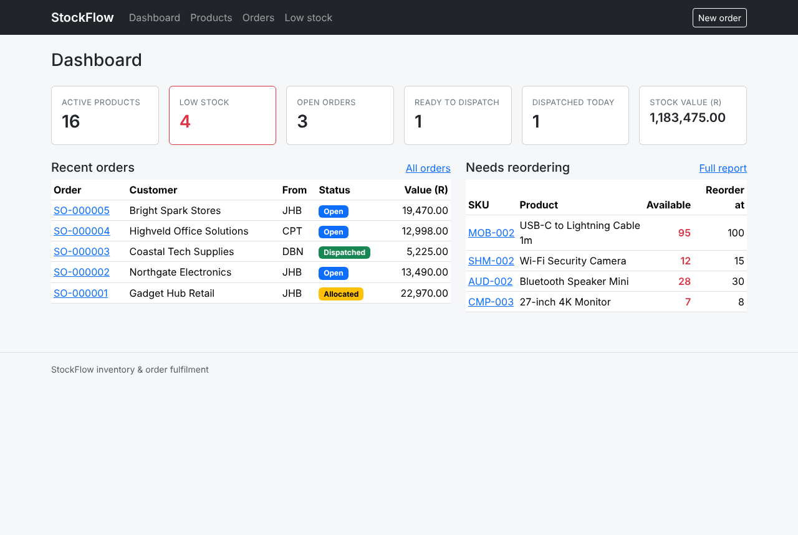
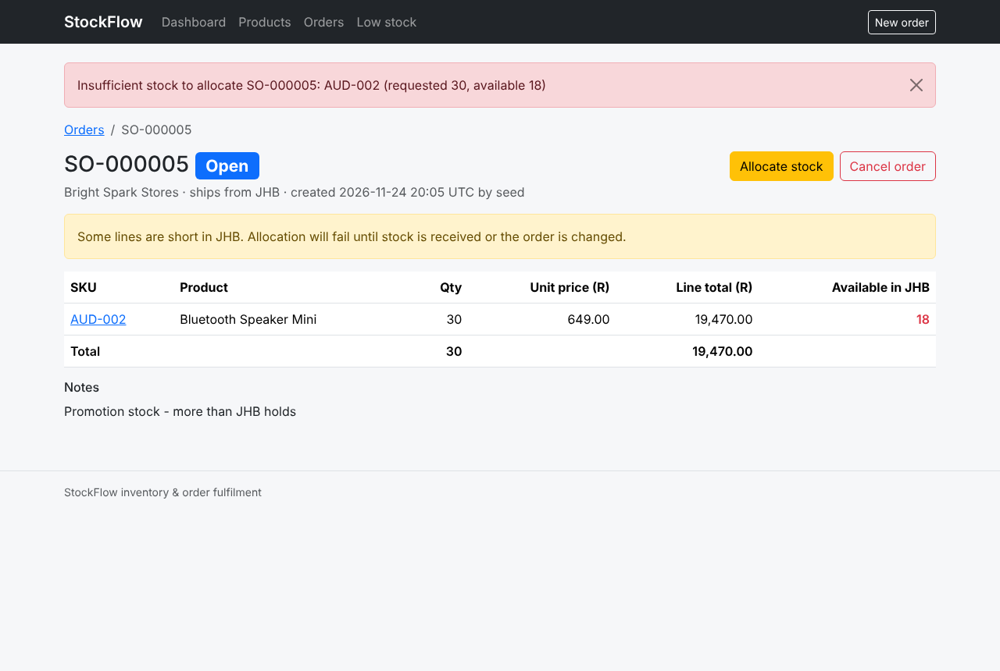
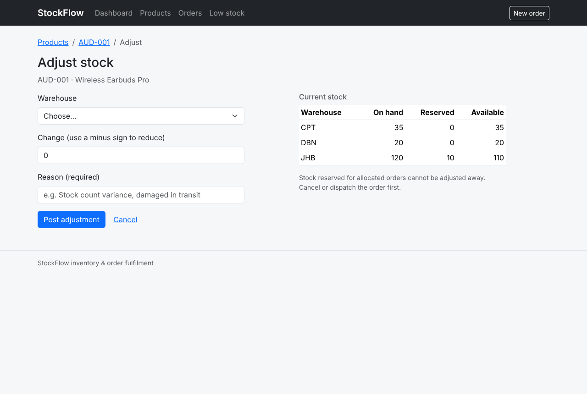

# StockFlow

StockFlow is an inventory and order-fulfilment system for a consumer-technology
distributor. It has two front ends that share one business layer and one
SQL Server database:

| Front end | Technology | Who uses it |
|---|---|---|
| **Back-office client** | VB.NET Windows Forms (.NET 8) | Warehouse staff: receive and adjust stock, allocate and dispatch orders, low-stock report |
| **Web portal** | ASP.NET Core MVC with Razor views (C#) | Sales and management: dashboard, products, sales orders, reports |

Both front ends call the same C# services, which call **Microsoft SQL Server
stored procedures**. The business rules (no overselling, no negative stock,
a full audit trail) are enforced in the services *and* again inside the
database transaction.



## How this maps to the job description

| The role asks for | Where to look |
|---|---|
| Maintain and enhance a **VB.NET Windows Forms** app | [`src/StockFlow.Desktop`](src/StockFlow.Desktop): `Option Strict On`, async UI, structured error handling, no designer spaghetti |
| **C#** development | [`src/StockFlow.Core`](src/StockFlow.Core) (domain, services, validation) and [`src/StockFlow.Data`](src/StockFlow.Data) (ADO.NET data access) |
| **SQL Server**: queries, joins, stored procedures | [`database/`](database): schema with constraints, 16 stored procedures, table-valued parameters, `UPDLOCK` locking, `TRY/CATCH` with an error log |
| **ASP.NET MVC with Razor** | [`src/StockFlow.Web`](src/StockFlow.Web): controllers, view models, Razor views, tag helpers, anti-forgery, Post/Redirect/Get |
| Connecting .NET to SQL Server reliably | [`SqlExecutor`](src/StockFlow.Data/SqlServer/SqlExecutor.cs): one place for connections, timeouts, safe retries and exception translation |
| Object-oriented design | Repository interfaces with two implementations, services with constructor injection, an exception hierarchy |
| Exception handling and error management | [`StockFlowException` hierarchy](src/StockFlow.Core/Exceptions/StockFlowExceptions.cs), [`SqlErrorTranslator`](src/StockFlow.Data/SqlServer/SqlErrorTranslator.cs), [web filter](src/StockFlow.Web/Infrastructure/StockFlowExceptionFilter.cs), [desktop `ErrorHandler`](src/StockFlow.Desktop/Infrastructure/ErrorHandler.vb), `dbo.ErrorLog` |
| Root-cause analysis, not temporary fixes | [`docs/rca/RCA-001-overselling.md`](docs/rca/RCA-001-overselling.md), plus the fixes for SF-087 and SF-112 called out in the code |
| Testing and regression testing | 85 automated tests: unit, **one contract suite run against both in-memory and real SQL Server**, and web tests that host the app |
| Performance | Catch-all queries with `OPTION (RECOMPILE)`, a table-valued parameter instead of one insert per line, parallel dashboard queries, search debouncing and double-buffered grids in WinForms |
| Code review, source control, change management | [`CONTRIBUTING.md`](CONTRIBUTING.md), [PR template](.github/pull_request_template.md), [CI](.github/workflows/ci.yml), [`CHANGELOG.md`](CHANGELOG.md) |
| Release support and documentation | [`docs/RELEASE.md`](docs/RELEASE.md), [`docs/TROUBLESHOOTING.md`](docs/TROUBLESHOOTING.md), [architecture](docs/ARCHITECTURE.md) and [decision records](docs/adr) |
| Distribution / inventory domain | The whole thing: warehouses, stock levels, reservations, sales orders, movements |

## Architecture

```
 VB.NET WinForms client           ASP.NET Core MVC + Razor
 (StockFlow.Desktop)              (StockFlow.Web)
          \                          /
           \                        /
            StockFlow.Core  (C#)  ── services, validation, order rules, exceptions
                  |
            StockFlow.Data  (C#)  ── IProductRepository, IOrderRepository, ...
               /        \
      SqlServer/          InMemory/
  (ADO.NET + stored     (same rules, no database:
   procedures)           demos and fast tests)
          |
   Microsoft SQL Server  ── tables, constraints, stored procedures, audit trail
```

More detail in [docs/ARCHITECTURE.md](docs/ARCHITECTURE.md).

## Quick start

You need the [.NET 8 SDK](https://dotnet.microsoft.com/download/dotnet/8.0).
The desktop app needs Windows; everything else runs on Windows, Linux or macOS.

### 1. Try it with no database (in-memory demo data)

```bash
dotnet run --project src/StockFlow.Web
# open http://localhost:5080
```

On Windows, run the VB.NET client the same way:

```bash
dotnet run --project src/StockFlow.Desktop
```

Both start in **InMemory** mode with demo data. Changes are lost when the app closes.

### 2. Run against SQL Server

Start SQL Server (any edition, 2017 or later; LocalDB, Developer or a Docker container), then deploy the database:

```bash
# SQL Server in Docker (skip if you already have one)
docker run -d --name stockflow-sql -e ACCEPT_EULA=Y -e "MSSQL_SA_PASSWORD=StockFlow!Dev123" -p 1433:1433 mcr.microsoft.com/mssql/server:2022-latest

# Create the database, apply migrations and procedures, load demo data
dotnet run --project tools/StockFlow.DbDeploy -- --seed-demo \
  --connection "Server=localhost,1433;Database=StockFlow;User Id=sa;Password=StockFlow!Dev123;TrustServerCertificate=True"
```

Then point the apps at it:

* **Web:** `dotnet run --project src/StockFlow.Web --launch-profile "StockFlow.Web (local SQL Server)"`
* **Desktop:** set `Provider` to `SqlServer` and fill in `ConnectionString` in
  `src/StockFlow.Desktop/appsettings.json`, or set the `STOCKFLOW_DESKTOP_CONNECTION`
  environment variable.

With Windows authentication use `Server=.;Database=StockFlow;Integrated Security=True;TrustServerCertificate=True`.

### 3. Everything in Docker

```bash
docker compose up --build
# open http://localhost:8080
```

## Running the tests

```bash
dotnet test
```

Without a database, the SQL Server contract tests are **skipped** and everything
else runs. To run them too, point `STOCKFLOW_TEST_SQL` at a server where you can
create databases. Each run creates a throw-away database and drops it afterwards:

```bash
# PowerShell: $env:STOCKFLOW_TEST_SQL = "..."
export STOCKFLOW_TEST_SQL="Server=localhost,1433;User Id=sa;Password=StockFlow!Dev123;TrustServerCertificate=True"
dotnet test
```

CI runs all of them against SQL Server 2022 and fails if any test was skipped.

| Suite | What it proves |
|---|---|
| `Services/*` | Validation, normalisation and order-state rules in the C# services |
| `Contracts/RepositoryContractTests` | The **same 18 tests** run against the in-memory store and against real SQL Server: round trips, optimistic concurrency, wildcard-safe search, all-or-nothing allocation, **concurrent allocations never oversell**, reservations released on cancel |
| `Web/WebSmokeTests` | Hosts the real MVC app: every page renders, 404s, the health check, correlation IDs, CSV export, and an end-to-end create-and-allocate order |
| `Data/DatabaseDeployerTests` | The `GO` batch splitter and migration naming |

## Project layout

```
database/
  migrations/        schema changes, run once each, tracked in dbo.SchemaVersion
  programmability/   stored procedures, re-applied on every deploy (CREATE OR ALTER)
  seed/              demo data
src/
  StockFlow.Core/    C#: models, services, validation, exceptions, repository interfaces
  StockFlow.Data/    C#: SQL Server and in-memory repositories, database deployer
  StockFlow.Web/     C#: ASP.NET Core MVC with Razor views
  StockFlow.Desktop/ VB.NET: Windows Forms back-office client
tools/
  StockFlow.DbDeploy/  command-line database deployment
tests/
  StockFlow.Tests/   xUnit: unit, contract (in-memory + SQL Server) and web tests
docs/                architecture, decision records, RCA, runbook, release process
```

## The order lifecycle

```
Open ──allocate──▶ Allocated ──dispatch──▶ Dispatched
  │                    │
  └──────cancel────────┴──▶ Cancelled (reserved stock is released)
```

* **Allocate** reserves stock in the order's warehouse for every line, or fails
  with a list of the short lines and changes nothing.
* **Dispatch** removes the reserved stock from on-hand.
* Stock reserved for an allocated order cannot be adjusted away.
* Every change writes a `StockMovement` row: who, when, how much and why.

## Screenshots

| Allocation refused, with the reason from SQL Server | Stock adjustment with the current position |
|---|---|
|  |  |
